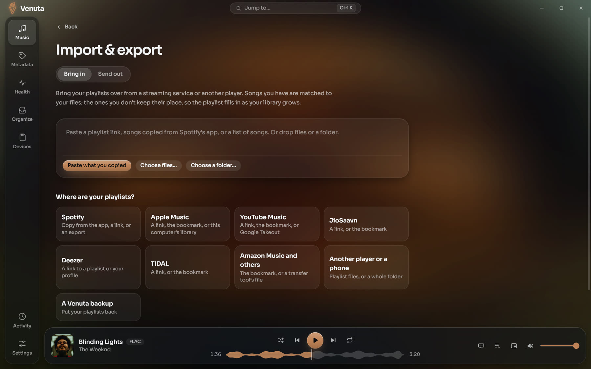

<div align="center">


# Venuta

**Your music, lossless and looked after.**

A music library and bit-perfect player for Windows. It keeps your files tidy, shows synced
lyrics everywhere, brings playlists in from any service, plays the online catalog beside your
own music, and writes SD cards for your portable player.

[](https://github.com/venuta-lab/venuta/releases/latest)
[](https://github.com/venuta-lab/venuta/releases)
[](https://github.com/venuta-lab/venuta/actions/workflows/ci.yml)
[](#install)
[](LICENSE)

[](crates)
[](https://tauri.app)
[](app)

**[Download for Windows](https://github.com/venuta-lab/venuta/releases/latest)** &nbsp;&nbsp;|&nbsp;&nbsp;
[Using Venuta](docs/GUIDE.md) &nbsp;&nbsp;|&nbsp;&nbsp; [What's new](CHANGELOG.md) &nbsp;&nbsp;|&nbsp;&nbsp;
[Themes](docs/THEMES.md)

<br>


</div>

<br>

Free and open source. No account, no ads, no tracking, and no AI at runtime.

|  |  |
|---|---|
| **Bit-perfect playback**<br>Exclusive WASAPI, gapless, hi-res as it was recorded. | **Lyrics everywhere**<br>Synced in Now Playing, on a big screen, floating over the desktop. |
| **Playlists in and out**<br>From Spotify, Apple Music, YouTube Music and more, free, no sign-in. | **Your library, then the world**<br>Search your files first, then the online catalog. |
| **A library that stays tidy**<br>Your rules, reviewed before anything changes, all undoable. | **Eighteen looks**<br>Or make your own in the Theme Studio and share it. |

## Listen


- **Bit-perfect** through exclusive WASAPI, gapless, with a waveform seek bar and a signal path
  that shows every step from the file to your speakers.
- **Synced lyrics** that follow the song; click a line to jump to it. **Big screen** (F11) puts
  them on a TV or a second monitor; **desktop lyrics** (Ctrl+Shift+D) float over every window.
  Six styles, in the cover's colour.
- **Time lyrics yourself**: for words with no timing, tap Space as each line begins.
- **When you want them**: a 10-band equaliser, tone, volume levelling by song or album,
  crossfade, a sleep timer, a mini player, the tray and media keys.

| | |
|---|---|
|  |  |
|  |  |

## Playlists, in and out


**Bring in** from anywhere, free and without signing in:

- **A share link** from Spotify, Apple Music, YouTube Music (the whole playlist, with its name),
  TIDAL, JioSaavn, Deezer (your favourites too) or ListenBrainz.
- **Songs copied** from Spotify's app, or a plain list of songs.
- **Any playlist file**, read by what's in it: M3U, PLS, XSPF, JSPF, WPL, ASX, CSV,
  spreadsheets and zips, or a whole folder from another player or a phone.
- **A bookmark** for playlists that only show when you're signed in.

You see what matched before anything is saved. Songs you don't have keep their place, marked,
so the playlist fills in as your library grows; **Check for new songs** keeps imported
playlists current.

**Send out** in any format, with paths for where it will be played (this PC, a phone, a card),
as one backup that brings every playlist back, or to Deezer, Apple Music, Spotify and YouTube
by finding your songs there. Playlists are plain `.m3u8` files beside your music, so every
player can read them.

| | |
|---|---|
|  |  |

## Search your library, then the online catalog


One search for everything, forgiving of spelling and across scripts ("kesariya" finds
केसरिया, in names and in lyrics). Your library always comes first; below it the online catalog
puts the real recording ahead of covers and remixes. Online songs play in the same player and
go into playlists and the queue beside your own.

## A library that stays tidy

- **Your rules** for folders, file names, artist spellings and categories. Every change is a
  plan you review first, then a build you can undo in **Activity**.
- **Looks up** original years, composers, lyricists, sharper covers and synced lyrics from
  free public sources.
- **Checks the sound**: damaged files, lossy sources passed off as lossless, fake hi-res, and
  loudness for levelling.
- **Health** shows how complete and how sound the library is, and what would fix it.

| | |
|---|---|
|  |  |

## Cards for portable players

**Devices** writes your whole library, or a selection of playlists, albums and artists, to an
SD card in your library's own layout. It converts to 16-bit FLAC or AAC for players that need
it, writes only what changed, and never touches files it didn't put there. A gift card adds a
tracklist and a list of what's missing; **Test this player** checks what a player can read.

## Make it yours


Eleven built-in themes after the players you know and a few retro ones, seven more as theme
files, light and dark. The **Theme Studio** makes a theme from a few colours or the album
playing, with the whole app as the preview; share it as one `.venuta-theme` file. Making
themes by hand or with an AI assistant: [docs/THEMES.md](docs/THEMES.md). Pick the app icon
too, in 33 materials.

<details>
<summary><b>Every theme, side by side</b></summary>
<br>

</details>

## What it will never do

- **Change the music you bring in.** The first build copies it into your library and changes
  only the copy.
- **Delete.** Duplicates, replaced files and removed playlists go to **Set aside**. Every change
  is journaled and can be undone in **Activity**.
- **Re-encode your audio.** Every tag write is checked: the audio before and after must match,
  or the file is left as it was.
- **Touch files on a card that it didn't put there.**
- **Download music.** The online catalog plays; it is never saved as files.

## Install

Download `Venuta_x.y.z_x64-setup.exe` from
[the latest release](https://github.com/venuta-lab/venuta/releases/latest) and run it. It
installs for your user, with no admin rights, on Windows 10 or 11. The installer isn't
code-signed yet, so SmartScreen may warn you: choose **More info**, then **Run anyway**.

**Updates come to you.** Once a day Venuta asks GitHub whether there is a new version and says
so; **Settings › About** shows what's new and installs it with one click, then restarts.
Every update is signed, and one that doesn't match Venuta's key is refused. Switch the daily
check off in the same place.

[Using Venuta](docs/GUIDE.md) walks through every place, the lyrics, shortcuts, and where
things are kept.

## Build it

Rust (stable), the MSVC build tools, Node 24 and pnpm 10:

```bash
pnpm --dir app install
pnpm --dir app tauri dev
```

[CONTRIBUTING.md](CONTRIBUTING.md) has the checks, how to test on a copy of a library, and how
to send a change. Security problems: [SECURITY.md](SECURITY.md).

| | |
|---|---|
| [`crates/engine`](crates/engine) | The library: scan, index, rules, plan and apply with undo, health, playlists, cards, lookups |
| [`crates/player`](crates/player) | Decoding, bit-perfect output, the sound tools |
| [`crates/media-access`](crates/media-access) | The online catalog |
| [`crates/cli`](crates/cli) | `venuta`, the engine from the command line |
| [`app/`](app) | The desktop app (Tauri) and its interface (React) |
| [`docs/`](docs) | [Decisions](docs/decisions), [research](docs/research), [plans](docs/plans) |

## Licence

MIT, see [LICENSE](LICENSE). Details come from [MusicBrainz](https://musicbrainz.org) (CC0),
the iTunes Search API, the Deezer API and [LRCLIB](https://lrclib.net), within their published
limits; Discogs and AcoustID optionally, with your own keys. The screenshots show a demo
library; album art and lyrics in them belong to their owners.
