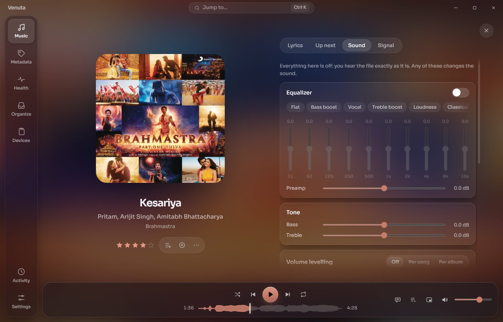
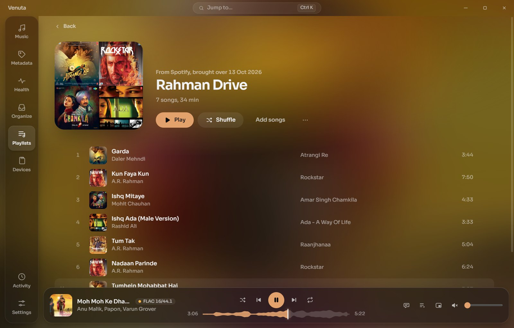
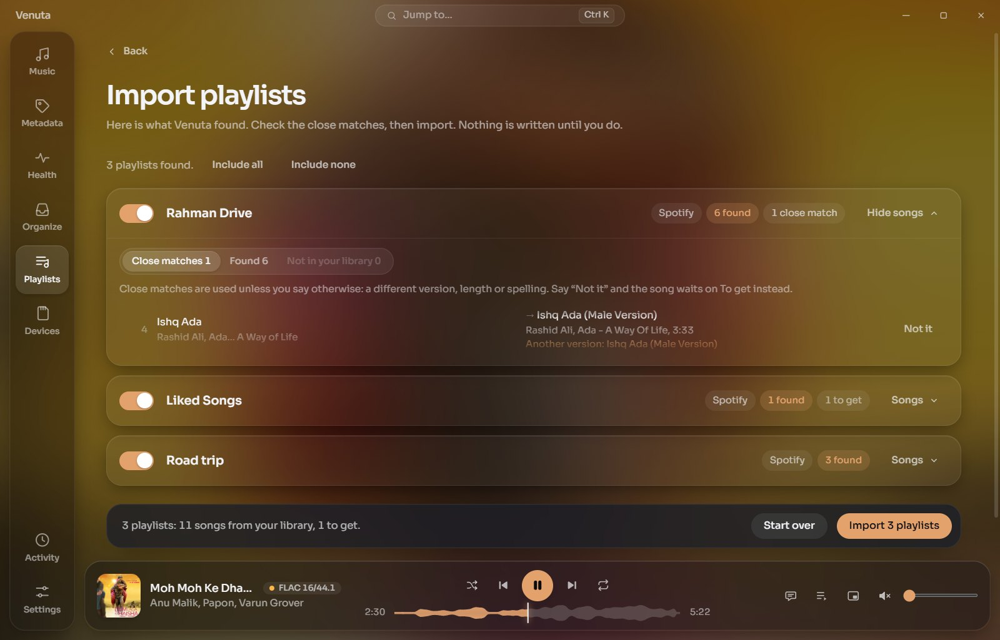
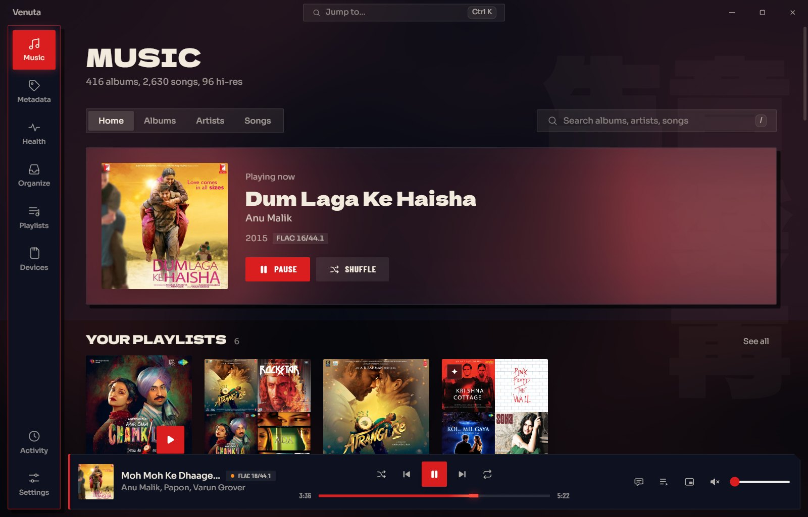

# Venuta (वेणुता)

*The essence of the flute.*

A free, open-source Windows app for a lossless music library: it builds and keeps the library
tidy, plays it bit-perfect, keeps your playlists from anywhere, and writes the library to SD
cards for portable players.


There is no AI at runtime, no account and no paid service, and the app never downloads music.

> Built for one person's library first, and shared as-is in case it helps you. No support is
> promised.

## What it does

- **Plays** your files bit-perfect (exclusive WASAPI), with a waveform seek bar, synced lyrics,
  a queue, an equaliser and volume levelling when you want them, and a mini player.
- **Keeps the library tidy** with your own rules: folder and file names, artist spellings,
  categories, covers and lyrics, as changes you review first and can undo.
- **Looks up** original years, composers, lyricists, sharper covers and synced lyrics from free
  public sources.
- **Checks the sound**: damaged files, lossy sources, fake hi-res, and loudness for levelling.
- **Brings your playlists over** from Spotify (sign in, or a file), Apple Music, YouTube Music,
  Deezer, TIDAL and others, matched to your files; songs you don't have keep their place until
  you do. Signing in to Spotify uses your own free Spotify app (steps in Settings, Online
  sources) and your browser; Venuta never sees your password.
- **Writes SD cards** for the player that reads them (Poweramp, Snowsky Disc, Echo Mini,
  Astell&Kern), changing only what changed.

| | |
|---|---|
|  |  |
|  |  |
|  |  |
|  |  |

## What it will never do

- **Change the music you bring in.** The first build copies it into your library and changes
  only the copy.
- **Delete outright.** Duplicates, replaced files and removed playlists go to **Set aside**
  beside your music. Every change is journaled and can be undone in **Activity**.
- **Re-encode audio.** Each tag write is verified: the audio before and after must match, or the
  file is left as it was.
- **Touch files on a card that it didn't put there.**

## The places

**Music** is where you listen: the album playing (or one picked for today), your playlists,
shelves (jump back in, most played, top rated, hi-res, your categories), then albums, artists
and songs. Click to play; right-click a song or an album for the rest, including **Add to
playlist…**.

**Metadata** lists the albums missing details; open one to edit its fields and song titles, and
rate songs.

**Health** shows how complete and how sound the library is, with the tools: look up details
online, measure loudness and check quality, rescan.

**Organize** tidies the library with your rules and files new music. What can be proven is done
for you, with its proof; what can't is asked, one question at a time, with the evidence side by
side.

**Playlists** are ordinary `.m3u8` files in your library, so any player can read them. Make
them, drag to reorder, import them from elsewhere, or let smart playlists fill themselves from
rules. **To get** lists the albums your playlists want and your library doesn't have.

**Devices** writes each SD card for its player. **Test this player** puts a short test album on
the card to check what your player reads (artists, covers, lyrics, playlists), and the card is
then written that way.

**Activity** lists every build, edit and answer, each with undo. **Settings** holds the look,
startup and the tray, folders, online sources and keys, safety, and updates.

Venuta keeps playing in the tray when you close the window (you're asked the first time), answers
media keys, and shows the song in the Windows media flyout.


Shortcuts: **Ctrl+K** opens the command palette, **Ctrl+1 to Ctrl+6** switch places, **Ctrl+,**
opens Settings, **Space** plays or pauses, **Ctrl+M** opens the mini player, **/** searches,
**?** lists every shortcut.

### Where things live

| What | Where |
|---|---|
| Your albums | `<library>\Music\` |
| Playlists | `<library>\Playlists\` |
| Set aside (never deleted) | `<library>\Set aside\` |
| Everything Venuta knows: settings, index, journals, caches | `<library>\.venuta\` |
| Which library is yours | `%APPDATA%\Venuta\library.json` |
| A card's identity and what it holds | `<card>\.venuta\` |

The whole library moves or backs up as one folder.

## Install

Download `Venuta_x.y.z_x64-setup.exe` from the [releases](../../releases) and run it. It installs
for your user only, with no admin rights. The installer isn't code-signed, so Windows SmartScreen
may warn you the first time: choose **More info**, then **Run anyway**.

Updates are signed: Venuta checks GitHub at most once a day (you can turn that off in Settings,
About) and installs a new version only when you choose.

## Development

Requirements: Rust (stable), Node 24 and pnpm 10, and on Windows the MSVC C++ build tools and
WebView2.

```bash
cargo test                                  # engine tests
cargo run -p cli -- scan <music-folder>     # headless scan (read-only)
pnpm --dir app install
pnpm --dir app tauri dev                    # the app with hot reload
```

The CLI (`venuta`) does the library work headless: `scan`, `health`, `deepcheck`, `plan`,
`apply`, `undo`, `tidy`, `incoming-plan`, `incoming-import`, `card-setup`, `card-sync`,
`apple-import` and `lookup`. Run `venuta --help` for details.

Releases: `node scripts/release.mjs <x.y.z> [--notes notes.md] [--publish]` sets the version,
builds the installer signed with the updater key (kept outside the repository), writes
`latest.json`, tags, and creates the GitHub release (a draft unless `--publish`).

| Folder | Contents |
|---|---|
| `crates/engine` | the library logic, no UI |
| `crates/player` | decoding, the bit-perfect output, sound tools |
| `crates/cli` | the headless binary `venuta` |
| `app/` | the Tauri shell and the React UI |
| `docs/` | plans, research and decision records |

## Licence

MIT, see [LICENSE](LICENSE). Details come from [MusicBrainz](https://musicbrainz.org) (CC0), the
iTunes Search API, the Deezer API and [LRCLIB](https://lrclib.net), each used within its
published limits; Discogs and AcoustID optionally, with your own keys. Album art in the
screenshots belongs to its owners.
