<div align="center">

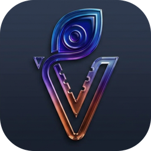

# Venuta

**Streaming-app polish for your own lossless library.**

Bit-perfect playback, synced lyrics everywhere, your streaming playlists matched to the files you
own, and your music player filled in one go. One beautiful, free app for Windows.

[](https://github.com/venuta-lab/venuta/releases/latest)
[](#install)
[](LICENSE)

### [Download for Windows](https://github.com/venuta-lab/venuta/releases/latest)

[Using Venuta](docs/GUIDE.md) &nbsp;&nbsp;|&nbsp;&nbsp; [What's new](CHANGELOG.md) &nbsp;&nbsp;|&nbsp;&nbsp; [Themes](docs/THEMES.md)

<br>

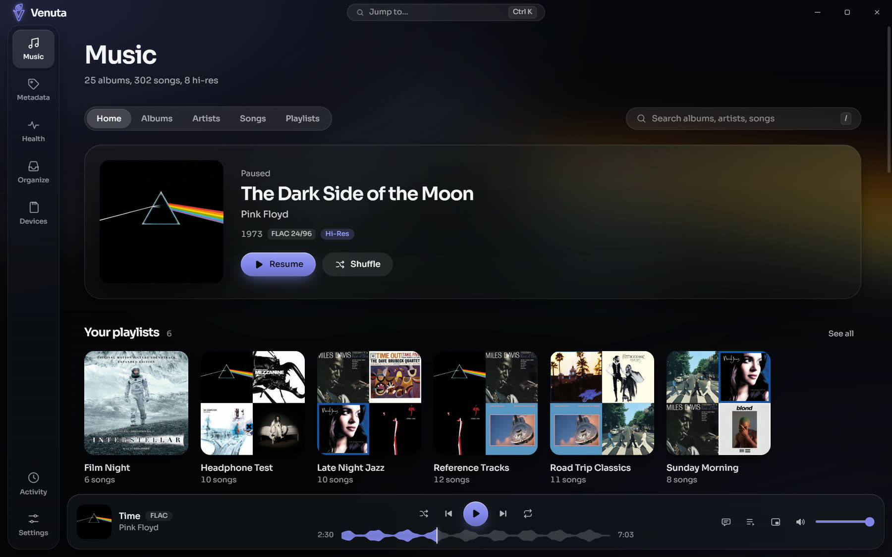

</div>

<br>

The good-looking music apps are all streaming apps, and the players for the music you own still
look like it's 2010. Venuta gives your FLAC collection the polish it deserves, and puts everything
you used to stitch together from plugins and separate tools in one place.

Free and open source. No account, no ads, no tracking.

|  |  |
|---|---|
| **Beautiful, on your own files**<br>Album-art backgrounds, 18 themes, a modern home for the music you own. | **Bring your playlists home**<br>Paste a Spotify, Apple Music or YouTube Music link. Matched to your files in seconds. |
| **Lyrics everywhere**<br>Synced in Now Playing, full screen on your TV, floating over your desktop. | **Your player, sorted**<br>Playlists and albums onto your DAP's card, written and converted for it. |
| **Know your FLACs are real**<br>Spots fake hi-res and lossy files dressed up as lossless. | **Bit-perfect, gapless, hi-res**<br>Exclusive WASAPI straight to your DAC, with every step shown. |

## Lyrics everywhere

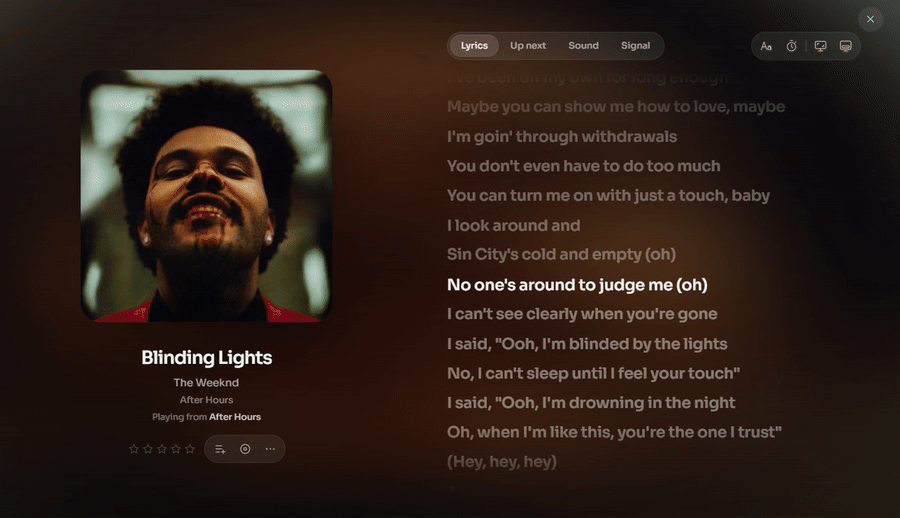

- **Synced lyrics** that follow the song, for most of your library, found for you. Click a line to
  jump to it.
- **Big screen** (F11) puts them on your TV or a second monitor. **Desktop lyrics**
  (Ctrl+Shift+D) float over every window, even your browser.
- **Six styles**, in the colour of the cover. Songs without timing? Tap along once and they're
  timed forever.

<p align="center">
  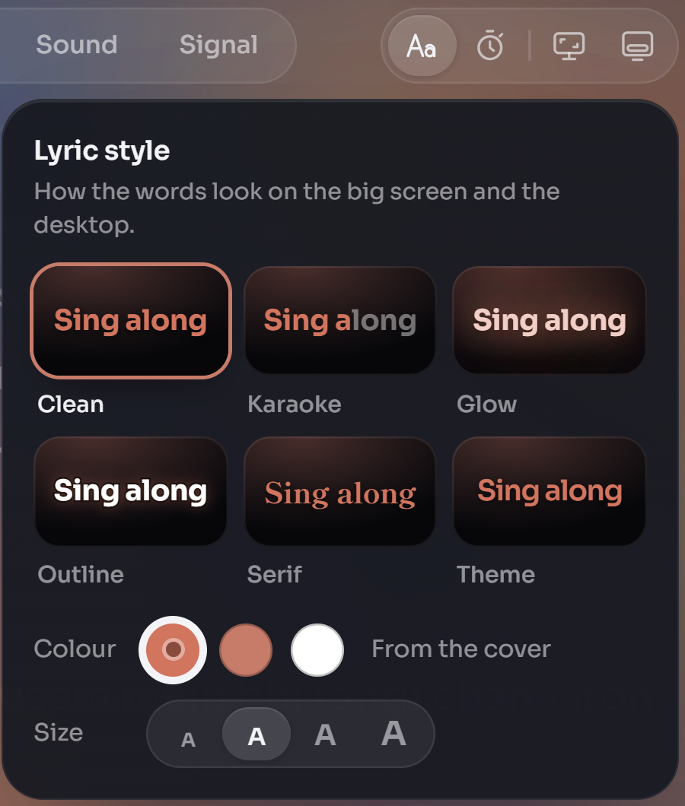
  &nbsp;&nbsp;&nbsp;
  
</p>

## Bring your playlists home

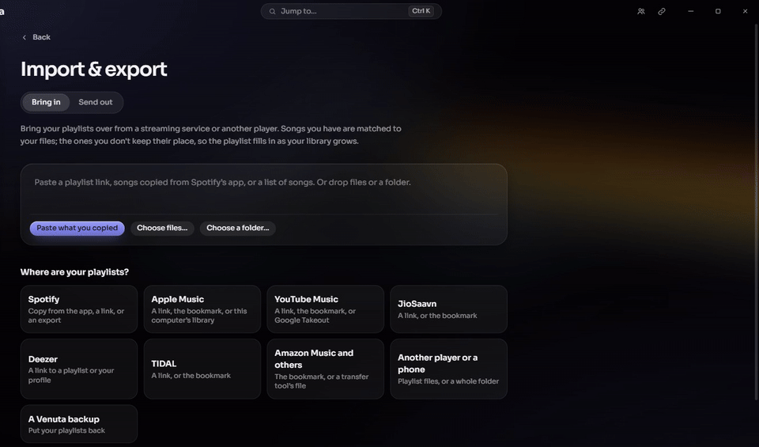

Leaving Spotify or Apple Music doesn't mean starting over.

- **Paste a link** from Spotify, Apple Music, YouTube Music, TIDAL, Deezer, JioSaavn or
  ListenBrainz. No sign-in, nothing to install.
- **Every song you own is matched** to your file, even across remasters and editions. The ones you
  don't have keep their place and fill in as your collection grows.
- **Any playlist file** from any player or phone works too: M3U, PLS, XSPF, WPL, CSV, even
  spreadsheets and zips.
- **Send them back out**: to any format and path layout, one backup of every playlist, or rebuilt on
  Deezer, Apple Music, Spotify or YouTube.

| | |
|---|---|
| 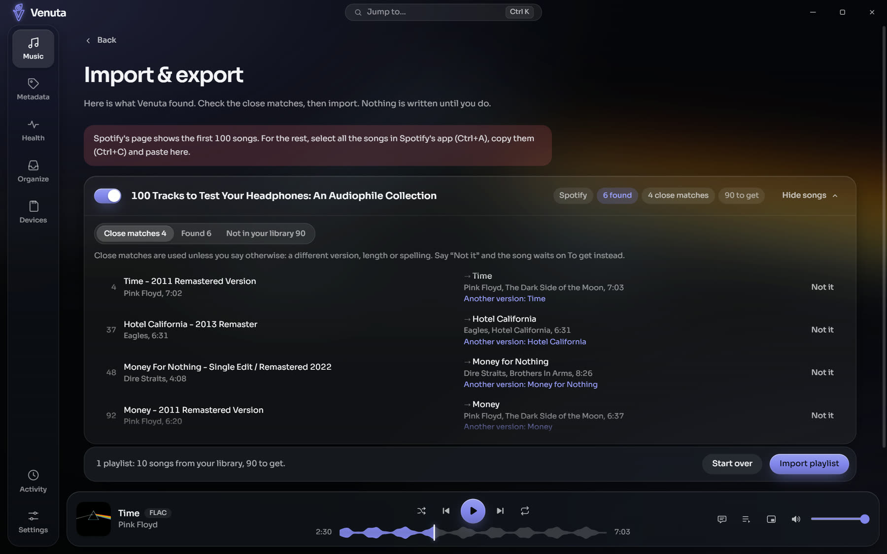 | 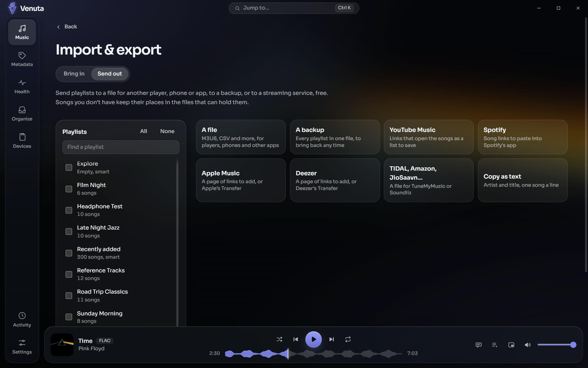 |

## Your player, sorted

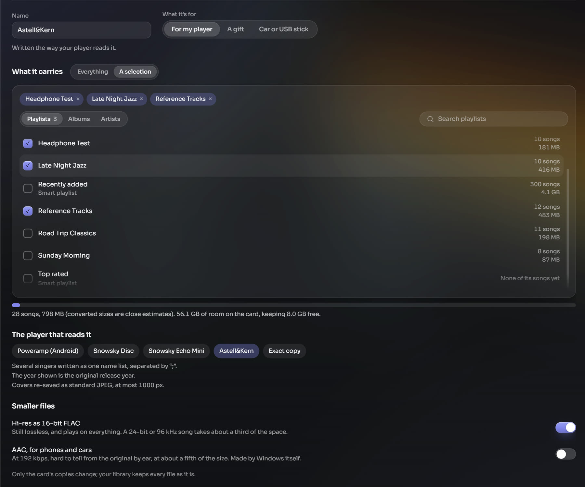

Plug in your DAP's SD card and pick what it carries: the whole library, or just the playlists,
albums and artists you want.

- **Written the way your player reads it**: ready-made profiles for Astell&Kern, the Snowsky Echo
  Mini and Disc, and Poweramp on Android, plus an exact copy for anything else. A car or USB stick,
  or a gift card for a friend, too.
- **Converted on the way**: hi-res as 16-bit FLAC (still lossless, a third of the size) or AAC for
  phones and cars. Your library is never touched.
- **Only what changed is written**, it picks up where it left off if you pull the card, it can sync
  itself the moment you plug it in, and it never touches files it didn't put there.

**Coming next**: phones and Android players over USB, and Wi-Fi sync to your phone, iPhone included.

## Bit-perfect, when it matters

- **Exclusive WASAPI**, gapless, hi-res as it was recorded. The **Signal** view shows every step
  from the file to your DAC, and tells you the moment anything changes the sound.
- **Every sound tool is off until you want it**: a 10-band equaliser, bass and treble, volume
  levelling by song or album, crossfade and a sleep timer.

| | |
|---|---|
| 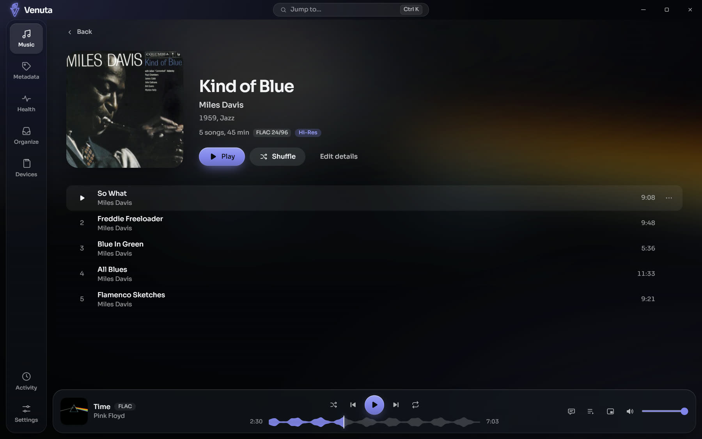 | 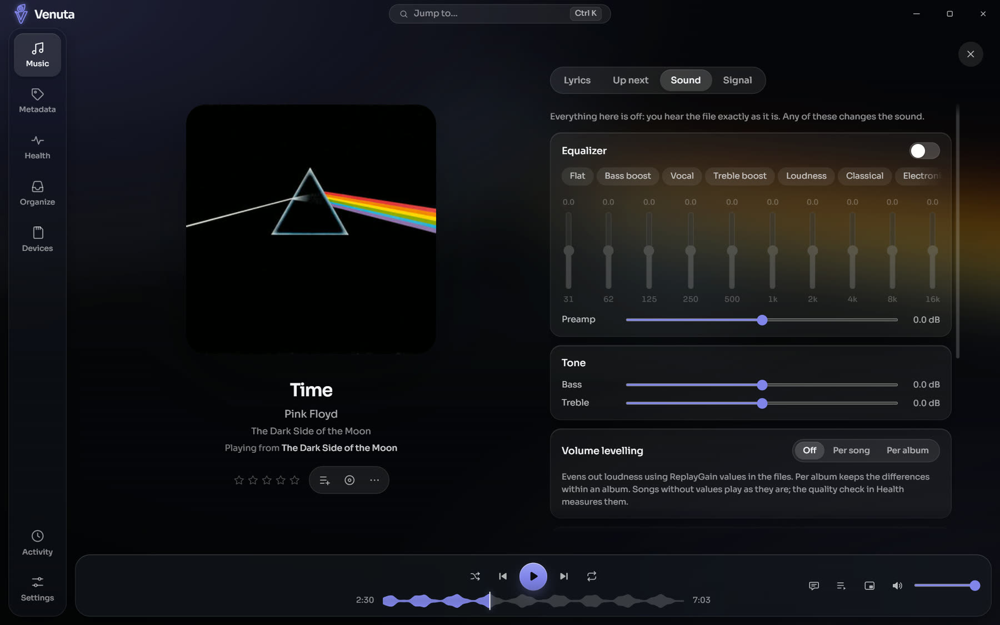 |

## Your library, looked after

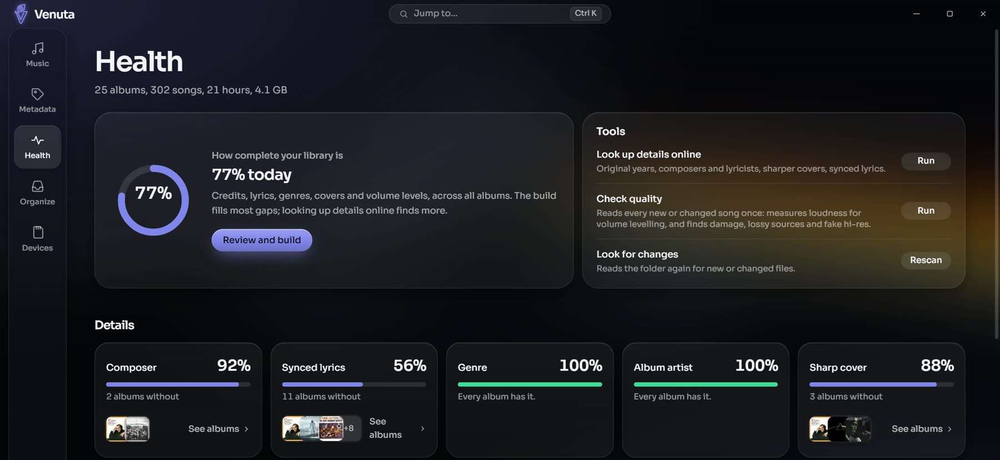

- **Know your FLACs are real**: damaged files, lossy sources passed off as lossless, and fake
  hi-res, all found for you.
- **Details filled in**: original years, composers, lyricists, sharper covers and synced lyrics,
  from free public sources.
- **Tidy without fear**: your own rules for folders, file names and artist spellings. Every change
  is shown before it happens, nothing is ever deleted, and everything can be undone.
- **Playlists are plain `.m3u8` files** beside your music, so every other player can read them too.

| | |
|---|---|
| 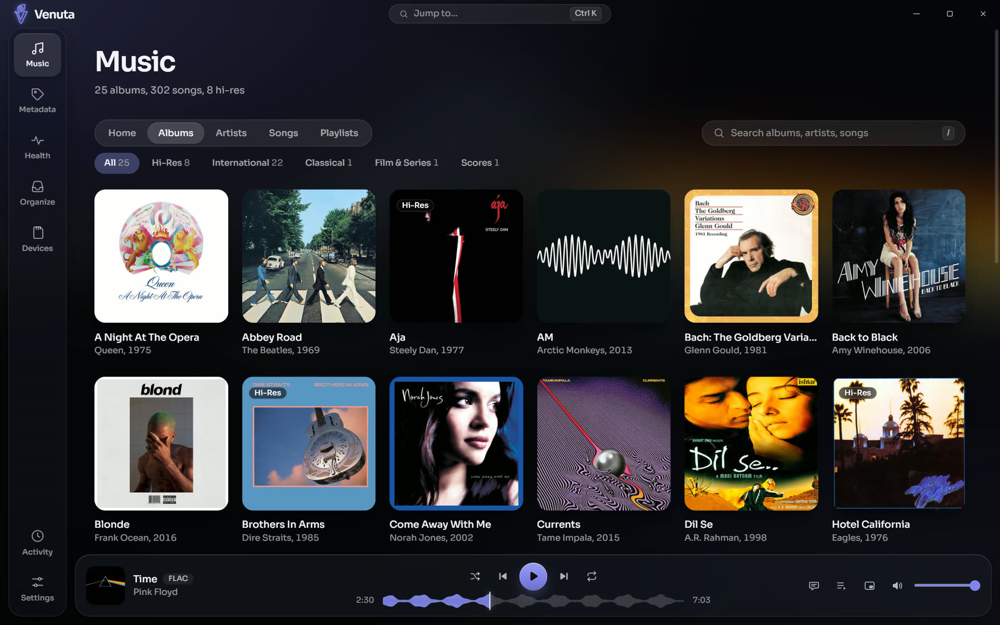 | 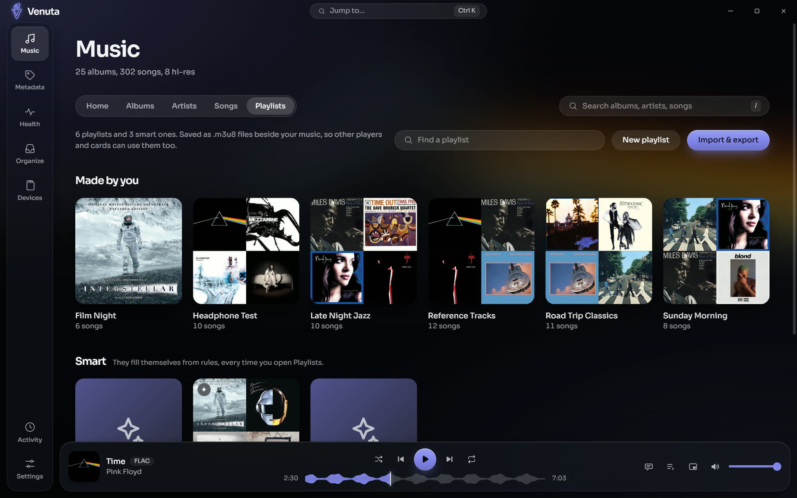 |

## Find anything

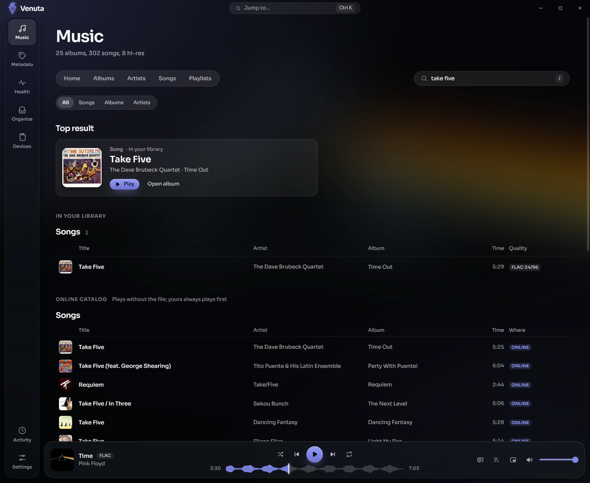

One search for everything, forgiving of spelling and across scripts: "kesariya" finds केसरिया, in
names and in lyrics. Your library comes first; below it, the online catalog plays songs you don't
own yet, with the original recording ahead of covers.

## Make it yours

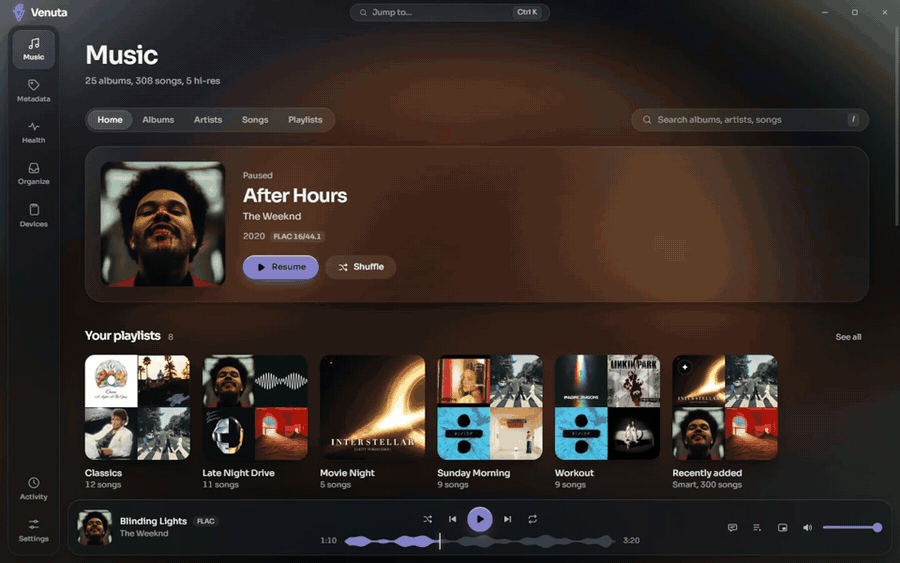

Eleven built-in looks, inspired by the players you know and a few retro classics, plus seven more as
theme files, in light and dark. The **Theme Studio** makes your own from a few colours or the album
playing, and shares it as one file. Pick the app icon too, in 33 materials.

<details>
<summary><b>Every look, side by side</b></summary>
<br>
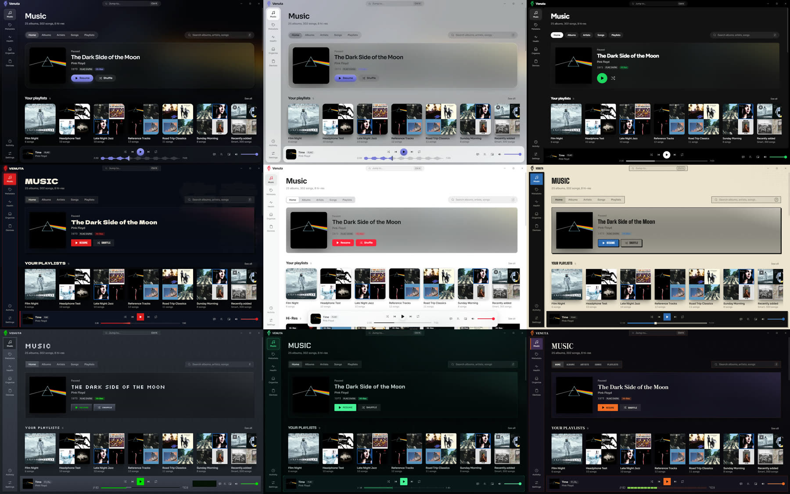
</details>

## Promises

- **Your music is never changed behind your back.** Every change is shown first, and every tag
  write is checked: if the audio isn't identical afterwards, the file is left as it was.
- **Nothing is deleted.** Replaced files and removed playlists go to **Set aside**, and everything
  can be undone in **Activity**.
- **No account, no ads, no tracking.** Your library stays on your PC.
- **Free, forever.** Open source under the MIT licence.

## FAQ

<details>
<summary><b>Is it really free?</b></summary>
Yes. Free and open source, with no account, no ads, no trial and no paid tier.
</details>

<details>
<summary><b>Is playback really bit-perfect?</b></summary>
In exclusive mode with the sound tools off, your DAC receives the file's samples untouched. The
Signal view in Now Playing shows every step, and says so the moment an equaliser, volume levelling
or crossfade changes them.
</details>

<details>
<summary><b>Will it work with my DAP or phone?</b></summary>
Anything that reads an SD card or shows up as a drive works today, with ready-made profiles for
Astell&Kern, Snowsky Echo Mini and Disc, and Poweramp on Android, and an exact copy for any other
player. Phones and Android players over USB, and Wi-Fi sync, are coming next.
</details>

<details>
<summary><b>Can I bring my Spotify or Apple Music playlists?</b></summary>
Yes: paste the playlist's share link, no sign-in. For a playlist longer than 100 songs, select the
songs in Spotify's app, copy them, and paste them in. Apple Music, YouTube Music, TIDAL, Deezer,
JioSaavn and ListenBrainz links work too.
</details>

<details>
<summary><b>Windows says it doesn't recognise the app. Is it safe?</b></summary>
The installer isn't code-signed yet, so SmartScreen doesn't know it. Choose <b>More info</b>, then
<b>Run anyway</b>. The source is all here, and every update Venuta installs is signed.
</details>

<details>
<summary><b>Where does my data live?</b></summary>
In your library folder (a hidden <code>.venuta</code> folder beside your music), so it moves with
your library. Nothing leaves your PC except what you ask for: lookups for lyrics and covers, the online catalog, and the daily check for updates.
</details>

## Install

Download `Venuta_x.y.z_x64-setup.exe` from
[the latest release](https://github.com/venuta-lab/venuta/releases/latest) and run it. It installs
for your user, without admin rights, on Windows 10 or 11.

**Updates come to you.** Venuta checks once a day and tells you when there's something new;
**Settings › About** shows what's new and installs it in one click.

[Using Venuta](docs/GUIDE.md) walks through every place, the lyrics, the shortcuts and where things
are kept.

## Build it

Rust (stable), the MSVC build tools, Node 24 and pnpm 10:

```bash
pnpm --dir app install
pnpm --dir app tauri dev
```

[CONTRIBUTING.md](CONTRIBUTING.md) has the checks and how to send a change; security problems go
through [SECURITY.md](SECURITY.md).

| | |
|---|---|
| [`crates/engine`](crates/engine) | The library: scan, rules, plans with undo, health, playlists, cards, lookups |
| [`crates/player`](crates/player) | Decoding, bit-perfect output, the sound tools |
| [`crates/media-access`](crates/media-access) | The online catalog |
| [`crates/cli`](crates/cli) | `venuta`, the engine from the command line |
| [`app/`](app) | The desktop app (Tauri) and its interface (React) |

## Licence

MIT, see [LICENSE](LICENSE). Details come from [MusicBrainz](https://musicbrainz.org), the iTunes
Search API, the Deezer API and [LRCLIB](https://lrclib.net), within their published limits. The
screenshots show a demo library; album art and lyrics belong to their owners.
