

# Venuta

**Streaming-app polish for your own lossless library.**

Your FLACs, played bit-perfect, with synced lyrics, friends listening along, and the online
catalog right beside them. Free for Windows.

### [Download for Windows](https://github.com/venuta-lab/venuta/releases/latest)

[Using Venuta](docs/GUIDE.md) &nbsp;&nbsp;|&nbsp;&nbsp; [What's new](CHANGELOG.md) &nbsp;&nbsp;|&nbsp;&nbsp; [Themes](docs/THEMES.md) &nbsp;&nbsp;|&nbsp;&nbsp; [Questions](docs/FAQ.md)

 

 

<table>
<tr>
<td width="50%" valign="top"><a href="#lyrics-everywhere">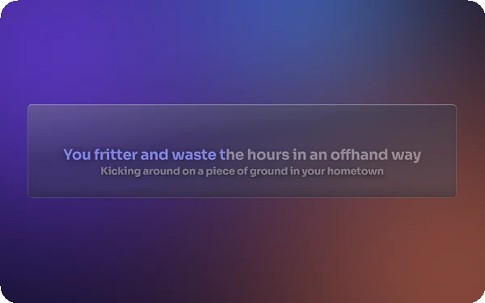</a> <b>Lyrics everywhere</b> In Now Playing, on your TV, and floating over every window.</td>
<td width="50%" valign="top"><a href="#listen-together">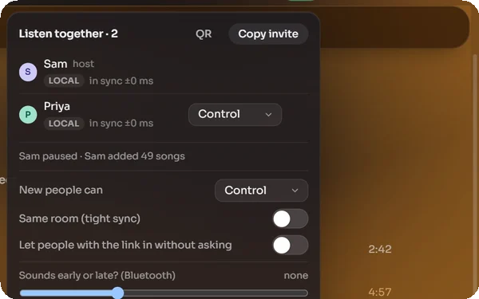</a> <b>Listen together</b> Friends hear the same moment, each from their best copy.</td>
</tr>
<tr>
<td width="50%" valign="top"><a href="#your-music-and-the-catalog-as-one">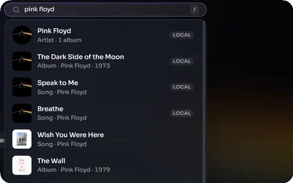</a> <b>Your music and the catalog, as one</b> One search, your files first. Or Local only.</td>
<td width="50%" valign="top"><a href="#bit-perfect-and-looked-after">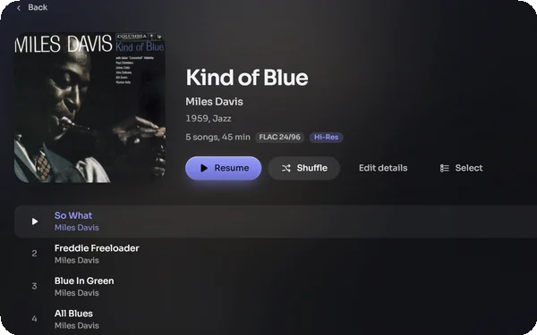</a> <b>Bit-perfect, gapless, hi-res</b> Exclusive WASAPI straight to your DAC.</td>
</tr>
<tr>
<td width="50%" valign="top"><a href="#bring-your-playlists-home">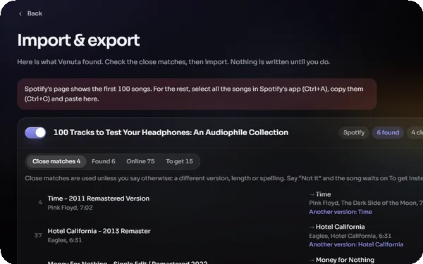</a> <b>Bring your playlists home</b> Paste a Spotify, Apple Music or YouTube Music link.</td>
<td width="50%" valign="top"><a href="#your-player-filled-in-one-go">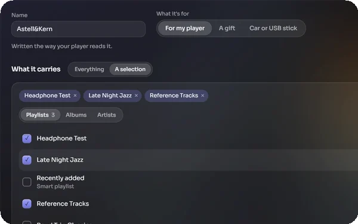</a> <b>Your player, filled in one go</b> Playlists and albums onto your DAP's card.</td>
</tr>
</table>

## Lyrics everywhere

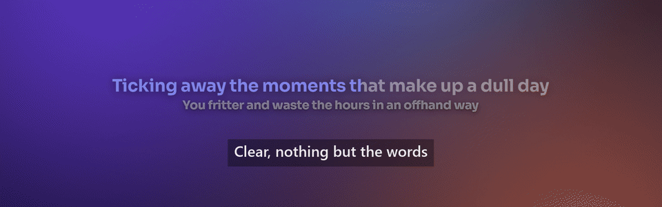

Synced lyrics that follow the song, found for you. **Desktop lyrics** (<kbd>Ctrl</kbd>+<kbd>Shift</kbd>+<kbd>D</kbd>)
float over every window: move them, size them, and lock them so clicks pass through. Clear,
Glass, Frosted, the cover's light or any theme. The **big screen** (<kbd>F11</kbd>) fills your TV.

  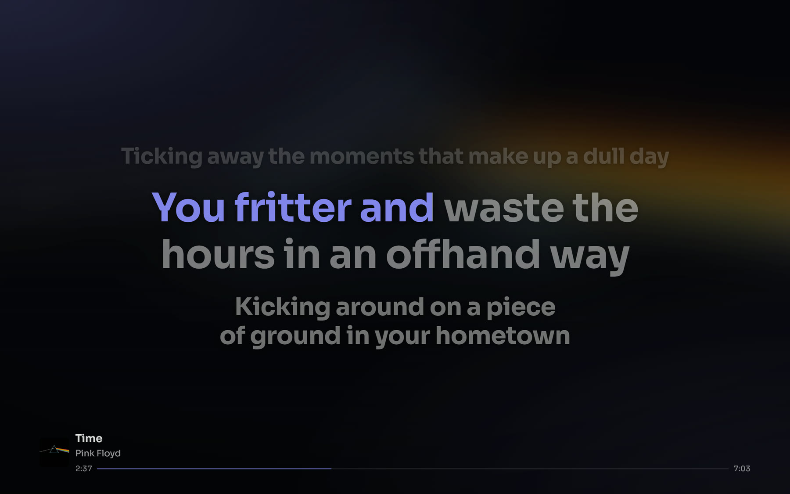
  

## Listen together

  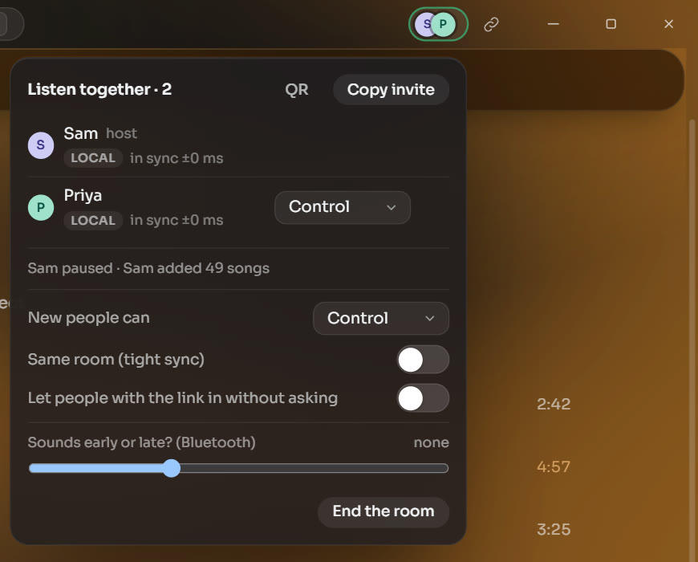
  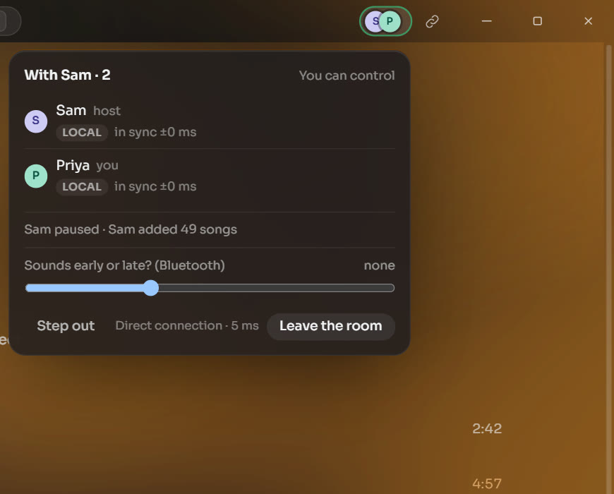
   
  Sam hosts; Priya joins from another PC. Each plays their own file of Fast Car, in sync to the millisecond.

Start a room, send the invite, and everyone hears the same moment, each from their best copy:
their own file, the online song, or yours streamed to them. Over the internet or your home Wi-Fi,
with no account. You choose who can control, add songs or just listen.

## Your music and the catalog, as one

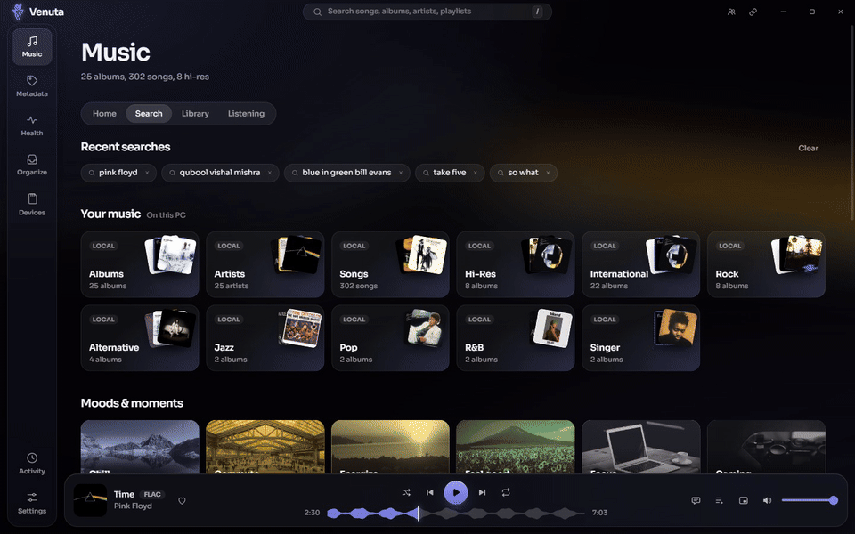

One search finds your files first, then the online catalog: albums, artists, playlists and moods
with pages like a music app's. Songs you don't own play straight away. **Local only** turns all
of it off.

## Bring your playlists home

Paste a link from Spotify, Apple Music, YouTube Music, TIDAL, Deezer or JioSaavn. Every song you
own is matched to your file, even across remasters; the rest keep their place and play online.

## Your player, filled in one go

Pick what your DAP's card carries, and Venuta writes it the way your player reads it, converting
hi-res to 16-bit FLAC on the way if you like. Over Wi-Fi, Subsonic apps on your phone play your
library too.

## Bit-perfect, and looked after

  
  

Exclusive WASAPI, gapless, hi-res as it was recorded, and every sound tool off until you want it.
**Health** spots fake hi-res and lossy files posing as lossless, and fills in what's missing.

## Make it yours

Eighteen looks, light and dark, and a **Theme Studio** that makes your own from the album playing.

<b>Every look, side by side</b>

 

## Promises

- **Your music is never changed behind your back.** Every change is shown first, and can be undone.
- **Nothing is deleted.** Replaced files and removed playlists go to Set aside.
- **No account, no ads, no tracking.** [What Venuta goes online for](PRIVACY.md).
- **Free, forever.** Open source under the MIT licence.

## Download

Get `Venuta_x.y.z_x64-setup.exe` from [the latest release](https://github.com/venuta-lab/venuta/releases/latest)
and run it: it installs for your user on Windows 10 or 11, no admin rights needed. If SmartScreen
asks, choose **More info**, then **Run anyway**. Updates come to you, signed, in one click.

 

  <a href="docs/GUIDE.md">Using Venuta</a> &nbsp;|&nbsp; <a href="docs/FAQ.md">Questions</a> &nbsp;|&nbsp; <a href="CONTRIBUTING.md">Build and contribute</a> &nbsp;|&nbsp; <a href="PRIVACY.md">Privacy</a> &nbsp;|&nbsp; <a href="SECURITY.md">Security</a> &nbsp;|&nbsp; <a href="LICENSE">MIT licence</a>

Details come from [MusicBrainz](https://musicbrainz.org), the iTunes Search API, the Deezer API and
[LRCLIB](https://lrclib.net), within their published limits. The screenshots show a demo library;
album art and lyrics belong to their owners.
