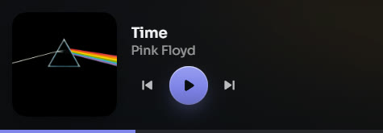

# Using Venuta

## The places

**Music** is where you listen: the album playing (or one picked for today), your playlists,
shelves (jump back in, most played, top rated, hi-res, your categories), then albums, artists,
songs and playlists. Click to play; right-click a song or an album for the rest, including **Add
to playlist…**. Play goes in order, Shuffle turns shuffle on, and the queue says where it is
playing from.

**Now Playing** (click the cover in the player bar) shows the song large, with its lyrics, what's
next, the sound tools and the signal path. Every artist and the album open their pages; **More**
has Show in folder and Search the web.

**Metadata** lists the albums missing details; open one to edit its fields and song titles, and
rate songs.

**Health** shows how complete and how sound the library is, with the tools: look up details
online, measure loudness and check quality, rescan, and the songs whose lyrics have no timing.

**Organize** tidies the library with your rules and files new music. What can be proven is done
for you, with its proof; what can't is asked, one question at a time, with the evidence side by
side.

**Playlists** (in Music) are ordinary `.m3u8` files in your library, so any player can read
them. Make them, drag to reorder, import them from elsewhere, or let smart playlists fill
themselves from rules. A playlist keeps every song, here or not: the ones you don't have play
from the online catalog in their places, so it plays straight through. Importing a playlist you already have fills it in and
keeps your own changes, and **Update from…** brings it up to date with its source. **To get**
lists the albums your playlists want and your library doesn't have.

**Import & export** (in Playlists) has two sides. **Bring in** takes a share link from Spotify,
Apple Music, YouTube Music, TIDAL, JioSaavn, Deezer or ListenBrainz, songs copied from an app,
a plain list, or any playlist file or folder of them, and shows what matched before anything is
saved; a bookmark reads playlists that only show when you are signed in. **Send out** writes
playlists in any format with paths for where they will be played, makes one backup of every
playlist, finds your songs on Deezer, Apple Music, Spotify or YouTube to rebuild a playlist
there, or copies it as text. **Check for new songs** looks at every imported playlist's source.
No account, nothing paid.

**Devices** writes SD cards for portable players. A card can carry the whole library or a
selection (playlists, albums, artists) in the library's own folder layout, converted to 16-bit
FLAC or AAC for players that need it; a gift card adds a tracklist and a list of what's missing.
**Test this player** puts a short test album on the card to check what your player reads.

**Activity** lists every build, edit, timing and answer, each with Undo. **Settings** holds the
look, startup and the tray, folders, online sources and keys, safety, and updates.

**The app icon** is yours to choose: Settings, Look and feel, App icon offers the Venuta mark (a V
with a peacock feather and a flute's holes) in 33 materials. Your choice is on the taskbar, the
tray, the windows and the shortcuts that open Venuta; the program file keeps Dusk glass.

## Lyrics

- **In Now Playing**, synced lyrics follow the song; click a line to jump to it.
- **Big screen** (F11): the lyrics on a whole screen, for a TV or a second monitor, with the
  next line coming in. Esc closes it, T adds Roman letters to lines in Indian scripts.
- **Desktop lyrics** (Ctrl+Shift+D, from anywhere, or the tray): the lines alone over every
  window; clicks pass through them. **Move desktop lyrics** in the tray unlocks them to drag,
  size and restyle.
- **Style**: Clean, Karaoke, Glow, Outline, Serif or your theme's own type, in the cover's
  colour, the accent or white, in four sizes. One choice for the big screen and the desktop.
- **Time lyrics yourself**: for words with no timing, play the song and press Space as each
  line begins; Backspace steps back, B marks a break, ← → nudge a line by a tenth of a second.
  The timing is saved as a `.lrc` beside the song (the song itself is never changed) and can be
  undone in Activity.

## Search

Search finds names and lyrics in any script and forgives spelling: "kesariya", "kesaria" and
केसरिया find the same song, and "dard mein zindagi" finds the line wherever it is written in
Devanagari.

Below your library, the **online catalog** answers too, with the real song ahead of covers and
remixes. Online songs play in the same player, and can go into playlists and the queue beside
your own. Your library always comes first.

## Shortcuts

| Keys | |
|---|---|
| Ctrl+K | Command palette: go anywhere, find anything |
| Ctrl+1 … Ctrl+5 | Music, Metadata, Health, Organize, Devices |
| Ctrl+H, Ctrl+, | Activity, Settings |
| / | Search your music |
| Space | Play or pause |
| Ctrl+← Ctrl+→ | Previous, next |
| L, Q | Lyrics, queue |
| F11 | Lyrics on the big screen |
| Ctrl+Shift+D | Desktop lyrics, from anywhere |
| Ctrl+M | Mini player |
| Ctrl+Shift+L | Light or dark |
| ? | Every shortcut |

Venuta keeps playing in the tray when you close the window (you're asked the first time), answers
media keys, and shows the song in the Windows media flyout.



## Where things live

| What | Where |
|---|---|
| Your albums | `<library>\Music\` |
| Playlists | `<library>\Playlists\` |
| Set aside (never deleted) | `<library>\Set aside\` |
| Everything Venuta knows: settings, index, journals, caches | `<library>\.venuta\` |
| Which library is yours | `%APPDATA%\Venuta\library.json` |
| A card's identity and what it holds | `<card>\.venuta\` |

The whole library moves or backs up as one folder.

## The command line

`venuta` does the library work without the window: `scan`, `health`, `deepcheck`, `plan`,
`apply`, `undo`, `tidy`, `tidy-undo`, `rules-init`, `covers`, `incoming-plan`,
`incoming-import`, `card-setup`, `card-sync`, `apple-import` and `lookup`. `venuta --help` lists
them with their options.

```bash
cargo run -p cli -- scan <music-folder>     # read-only
```

## Sources

Details come from [MusicBrainz](https://musicbrainz.org) (CC0), the iTunes Search API, the
Deezer API and [LRCLIB](https://lrclib.net), each used within its published limits; Discogs and
AcoustID optionally, with your own keys.
